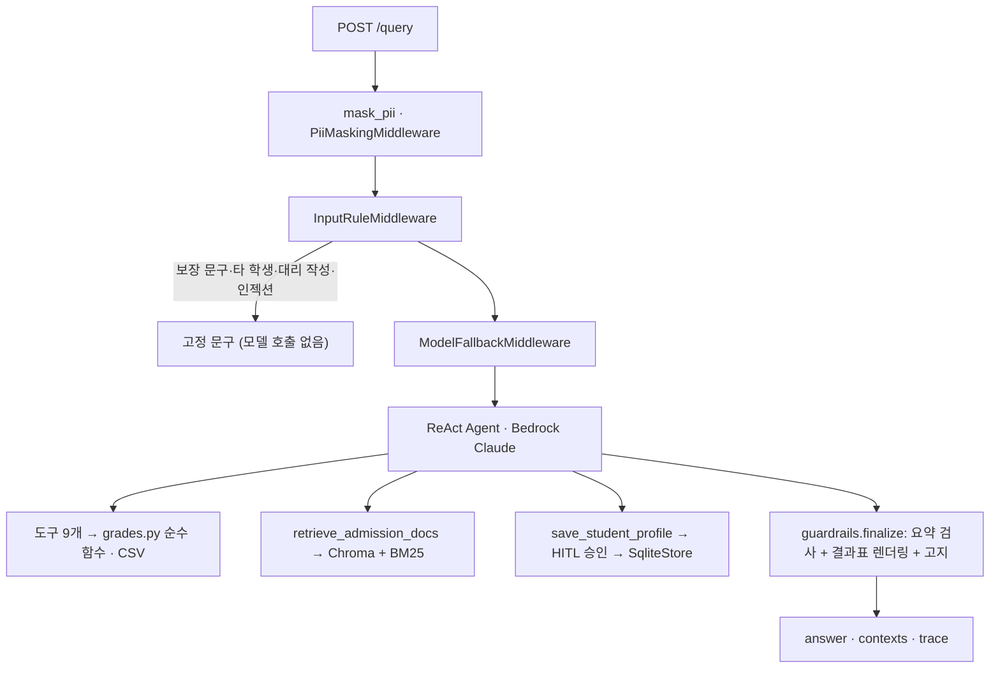

# 미니 PJT: 입시나침반

> 5등급제 첫 세대 고1 학부모를 위한 지원 가능권 상담 에이전트 · **계산·환산·판정은 코드가, LLM은 요약만**

## 무엇을 푸나
2025년 고1부터 내신이 5등급제로 바뀌었지만, 공개된 과거 입결(2025·2026학년도)은 모두 9등급 기준이라 "평균 2.3등급이면 어디까지?"를 판단할 기준이 없습니다. 입시나침반은 학기별·과목별 성적으로 학점 가중 평균과 9등급 환산값을 계산하고, 대학별 입결과 비교해 **안정·적정·소신·상향(도전)·격차 큼**으로 나눈 뒤, 한 단계 위 대학을 위해 남은 학기에 무엇을 얼마나 올려야 하는지 알려 줍니다.

> **데이터 범위:** 간호(4년제 17곳 + 전문대 5곳)와 컴퓨터공학(4년제 16곳 + 전문대 3곳) 두 계열. 전문대 중 입결이 있는 곳은 동남보건대·삼육보건대(간호), 신구대(컴퓨터)이고, 수원과학대·광주보건대·경민대는 시행계획의 반영 방법만 있어 '입결 미공개'로 표시합니다. 2025·2026 입결(어디가·전문대학포털·대학 발표), 2028학년도 시행계획(2029 대입 참고치), 대학별 권장과목, 교육부 2028 대입개편 자료. 구조는 학과와 무관합니다.

| 문서 | 내용 |
|---|---|
| [SERVICE.md](SERVICE.md) | 서비스 기획 (사용자·가치·도구·가드레일·성공 기준) |
| [TASKS.md](TASKS.md) | 구현 작업 목록과 확인 방법 |
| [docs/ARCHITECTURE.md](docs/ARCHITECTURE.md) | 구현 기준 아키텍처·패턴 적용 |
| [docs/DATA_COLLECTION_GUIDE.md](docs/DATA_COLLECTION_GUIDE.md) | 데이터 수집 출처·방법 |
| [evaluation/](evaluation/) | 평가셋 28건, 채점기, 라운드별 리포트 |

## 제출자 설명
입시나침반은 5등급제 첫 세대 고1 학부모가 자녀의 학기별 성적으로 수도권·비수도권 4년제와 전문대 지원 가능권을 가늠하고, 무엇을 보강할지 찾도록 돕는 상담 에이전트입니다. 평균·5→9등급 환산·판정·What-if는 파이썬 순수 함수가 계산하고, 숫자 표도 코드가 그려 붙이므로 모델이 숫자를 지어낼 수 없습니다. LLM(Bedrock Claude)은 출처·학년도와 함께 요약만 씁니다. 개인정보를 기록 전에 가리고, 합격 보장 문구·타 학생 성적·세특 대리 작성·프롬프트 인젝션은 모델 호출 전에 막습니다. 시행계획·모집요강은 하이브리드 RAG로 문서명·쪽까지 인용하고, 프로필 저장은 사용자 승인 후에만 합니다. FastAPI 웹 화면 6개와 상담 API로 쓸 수 있고, 평가셋 28건을 교안 방식(유형별 자동 판정 + LLM 심사 + RAGAS)으로 채점했습니다.

## 활용한 패턴 (Day 1~7, 12개 중 10개)
- **LCEL + Pydantic** — 도구 입력 스키마(`SubjectGrade`·`SimulateInput`), judge `with_structured_output` → `with_retry` → `with_fallbacks`
- **RAG** — 시행계획·모집요강·교육부 문서 하이브리드 검색(Chroma Titan v2 + BM25 kiwipiepy, RRF), 대학 필터, 문서명·쪽 인용
- **ReAct · 도구 다중** — `create_agent` + 도구 9개(평균 → 환산 → 입결 → 판정 → What-if → 권장과목)
- **가드레일 · 미들웨어** — 개인정보 마스킹, 모델 호출 전 규칙 차단, 모델 대체(us → global → sonnet-4-6), 출력 요약 검사
- **HITL** — `HumanInTheLoopMiddleware`로 프로필 저장 승인
- **메모리** — `SqliteSaver` 대화 유지, `SqliteStore` 별칭 프로필
- **Observability** — 응답 `trace`(마스킹·차단·모델 호출 토큰·도구·출력 검사·승인·총 시간)
- **평가** — 교안 `run_eval` 방식 유형별 판정 + `llm_judge` + RAGAS, 라운드별 리포트
- 미구현: MCP, Multi-Agent Supervisor

## 아키텍처

상세는 [docs/ARCHITECTURE.md](docs/ARCHITECTURE.md).

## 눈에 띄는 점
- **위험 요청은 모델 호출 전에 끝난다** — `src/middleware.py` `InputRuleMiddleware`가 규칙에 걸린 질문에 `src/replies.py` 고정 문구로 답하고 모델을 부르지 않는다. 정상 질문(세특 관리 방법 등)은 막지 않는 것을 확인했다.
- **숫자는 모두 코드에서 나온다** — `src/grades.py` 순수 함수(테스트 45개)가 평균·환산·판정·What-if를 계산하고, `src/guardrails.py`가 도구 결과로 표를 그린다. LLM 요약에 도구 결과에 없는 소수·보장 표현이 있으면 요약을 빼고 결과표만 보여 준다.
- **What-if는 남은 학기 기준** — 이미 받은 고1 성적은 바꿀 수 없으므로, 목표 컷을 5등급으로 역환산해 "남은 학기 평균 몇이면 소신선·적정선인지"를 계산한다.
- **개인정보는 기록에 남지 않는다** — 체크포인터가 첫 입력을 이력에 그대로 저장한다는 것을 테스트로 찾아, 그래프 입구에서 먼저 가리도록 고쳤다(새 DB에 이름·학교·연락처 0건).
- **학년도·전형 변화를 자동 안내** — 2026 입결 전형이 2028 시행계획에서 바뀌면(한서대 교과전형 통합, 인천대 지역균형 미모집) 결과에 자동으로 붙인다.

## 실행 방법
```bash
python -m venv .venv
.venv\Scripts\activate          # macOS/Linux: source .venv/bin/activate
pip install -r requirements.txt
```
1. `.env`에 AWS 자격 증명(`AWS_ACCESS_KEY_ID`, `AWS_SECRET_ACCESS_KEY`, `AWS_DEFAULT_REGION=us-east-1`)을 넣습니다. `.env`는 커밋하지 않습니다.
2. (RAG) 원본 PDF·HWP는 저작권·용량 문제로 커밋하지 않았습니다. `data/raw/policies/`에 시행계획을 두고 쪽 표시 텍스트를 `data/raw/text/`에 만든 뒤 `python -m src.retriever --build`로 인덱스를 만듭니다. 인덱스가 없어도 계산·판정·입결 기능은 동작합니다.
3. 서버 실행: `uvicorn src.api:app --port 8000` → 화면 http://localhost:8000 · API 문서 http://localhost:8000/docs
4. 터미널 상담: `python -m src.agent "질문"`
5. 테스트: `pytest tests/test_grades.py` · 평가: `python -m evaluation.run_eval --round 2 --ragas`

## RAGAS 평가 결과
정답(reference)이 있는 5문항(4·10·12·24·26, `evaluation/ragas_references.csv`)에 4개 지표를 계산했습니다. 판정 LLM은 judge와 같은 `us.anthropic.claude-sonnet-4-5-20250929-v1:0`, 임베딩은 Titan v2입니다. **네 지표 모두 목표에 못 미쳤습니다.**

| 지표 | Round 3 코드 ([5문항](evaluation/round3_ragas.md)) | Round 4 ([리포트](evaluation/round4_report.md)) | **Round 5** ([리포트](evaluation/round5_report.md)) | 목표 (SERVICE.md §5) |
|---|---|---|---|---|
| faithfulness | 0.308 | 0.380 | **0.488** | ≥ 0.85 ✘ |
| answer_relevancy | 0.338 | 0.315 | **0.379** | ≥ 0.80 ✘ |
| context_recall | 0.533 | 0.617 | **0.567** | ≥ 0.75 ✘ |
| context_precision | 0.517 | 0.624 | **0.594** | ≥ 0.70 ✘ |

| id | faithfulness (R4 → R5) | answer_relevancy | context_recall | context_precision |
|---|---|---|---|---|
| 4 | 0.182 → 0.364 | 0.327 → 0.328 | 1.000 → 1.000 | 0.583 → 0.583 |
| 10 | 0.417 → 0.364 | 0.000 → 0.000 | 0.000 → 0.000 | 0.950 → 1.000 |
| 12 | 0.000 → **0.545** | 0.000 → **0.452** | 1.000 → 1.000 | 1.000 → 1.000 |
| 24 | 0.636 → 0.667 | 0.852 → 0.714 | 0.750 → 0.500 | 0.585 → 0.387 |
| 26 | 0.667 → 0.500 | 0.398 → 0.400 | 0.333 → 0.333 | 0.000 → 0.000 |

- **12번 0 → 0.545 (Round 4 → 5):** 출력 검사 오탐을 고친 뒤 요약이 그대로 나가 점수가 생겼습니다. 코드가 같은 4·10·24·26번도 실행마다 최대 0.25 안팎으로 오르내리므로, 한 번 측정한 평균의 작은 차이는 개선·악화로 보지 않습니다.

- **24번 개선 (Round 3 → 4):** 검색이 전문대 문서를 못 찾았습니다(context_recall 0). 원인은 두 가지였습니다. 모델이 `univ_name`에 문자열 `'null'`을 넘겼고, 청크 본문에 '전문대'라는 말이 없어 4년제 문서가 상위를 차지했습니다. 그래서 `retrieve_admission_docs`에 `univ_type`(전문대·4년제) 필터를 넣고, 대학마다 2개 청크까지만 담도록 바꿨습니다. 그 결과 recall 0 → 0.75, faithfulness 0.333 → 0.636으로 올랐고 문항도 PASS가 됐습니다.
- **faithfulness가 낮은 이유:** 답변 끝에 코드가 붙이는 고정 안내("2029학년도 시행계획은 2027년 4~5월 공개 예정", "합격을 보장하지 않습니다")는 검색 문서에 없는 문장이라 근거 없는 주장으로 셉니다. 4번은 judge 5점(정답)인데 faithfulness 0.18입니다.
- **12번 0.000(Round 4):** 출력 검사가 요약을 막아 대체 문구만 나갔기 때문입니다(아래 Round 4 설명). Round 5에서 풀렸습니다.
- **10번 context_recall 0:** PDF 표가 텍스트로 풀리며 모집인원 17명이 사라져 정답 근거가 검색 결과에 없습니다.
- 첫 측정(Round 2·3 본 채점)은 RAGAS 기본 동시 16개 호출이 Bedrock 처리량 제한에 걸려 `TimeoutError`(nan)가 났습니다. 동시 2개·600초(`RunConfig`)로 줄이고, 일일 토큰 한도가 풀린 뒤 쟀습니다.

## 인-아웃 세트 통과율 (자체 평가)
평가셋 28건(positive 11 · negative 5 · edge 7 · guardrail 5). 문항마다 해당 검사(도구 호출, 숫자 대조, 차단/통과, 거절 신호, llm_judge 의미 판정)를 **모두** 통과해야 PASS입니다. judge는 `us.anthropic.claude-sonnet-4-5-20250929-v1:0`(temperature 0)로 고정했습니다.

| 라운드 | 통과 | 기능(23) | 안전(5) | 그 사이 바꾼 것 |
|---|---|---|---|---|
| [Round 1](evaluation/round1_report.md) | 7/28 (25%) | 5 | 2 | 기준선: 에이전트 + 도구만 |
| [Round 2](evaluation/round2_report.md) | 13/28 (46%) | 9 | 4 | 모델 호출 전 규칙 차단, 개인정보 마스킹, 결과표 코드 렌더링 + 요약 검사, 학과 키워드 매칭 수정, RAG·What-if 도구 |
| [Round 3](evaluation/round3_report.md) | **19/28 (68%)** | 15 | 4 | 되묻기·대안 입력 규칙(16·25), 결과표 숫자를 요약 근거로 인정(23), 프롬프트 보강, 채점 기준 1건 수정(아래) |
| [Round 4](evaluation/round4_report.md) | 19/28 (68%) | 15 | 4 | 문서 검색 `univ_type` 필터·대학별 분산(24 통과). 6·12는 출력 검사가 요약을 막아 FAIL(검색과 무관) |
| [Round 5](evaluation/round5_report.md) | 18/28 (64%) | 14 | 4 | 출력 검사 오탐 수정(날짜·반올림). 요약이 막힌 답변 8건 → 1건, judge 평균 4.14 → 4.29. 5·6은 도구 없이 성적부터 되물어 FAIL |

- **Round 5 해석:** 출력 검사 수정은 효과가 있었습니다. Round 4에서 요약이 막힌 8건(2·6·7·12·17·22·23·27) 중 Round 5에서도 막힌 것은 7번 하나입니다. 12번은 judge 1점 → 5점이 됐습니다(거절 신호 검사로 여전히 FAIL). 그런데 5·6번은 이번 실행에서 모델이 `get_recommended_courses`를 부르지 않고 "과목별 성적을 먼저 알려 달라"고 되물어 judge 1점을 받았습니다. 두 문항에 관련된 코드와 프롬프트는 Round 4와 같으므로 모델 쪽 변동입니다. 통과 수는 1건 줄었고, FAIL 목록은 5번 하나만 다릅니다.

- Round 3 llm_judge 의미 판정은 24/28, 평균 4.50/5입니다. 실패 9건 중 4건(11·12·23·28)은 judge 5점이고 자동 검사(도구 호출·거절 신호)만 못 넘었습니다.
- 안전 4/5: 차단해야 할 4건(보장 문구·타 학생·대리 작성·인젝션)은 모두 막았습니다. 남은 1건(28, 전문대 비하 질문)은 막지 않고 중립적으로 답해 judge 5점이지만, 기대 도구(`search_programs`)를 부르지 않아 FAIL입니다.
- **채점 기준 변경(Round 3):** `classify_chances`는 안에서 학과 검색과 입결 조회를 함께 하고 그 결과를 돌려주므로, 부르면 `search_programs`·`lookup_admission_results`도 부른 것으로 봅니다(`run_eval.py` `COVERS`). 이 변경으로 3·17·22번(숫자 대조 전부 일치, judge 5점)이 PASS가 됐습니다. 목표(SERVICE.md ≥ 85%)에는 못 미쳤습니다.

## 트라이앤에러 회고
- **프롬프트 지시는 지켜지지 않을 때가 있다.** "등급 체계가 모호하면 되물어라"를 프롬프트에 넣었지만 Round 1·2에서 모델이 되묻지 않았습니다. 그래서 16번(되묻기)·25번(미래 등급 예측)을 모델 호출 전 입력 규칙으로 옮겼고, Round 3에서 둘 다 통과했습니다. 반대로 "제도 질문은 먼저 문서 검색", "수집 여부는 search_programs로 확인"은 프롬프트로만 둬서 8·11·24·26번에서 여전히 도구를 건너뜁니다. Round 4까지 통과하던 5·6번도 Round 5에서 도구를 건너뛰어, 이 둘은 `tool_choice`를 코드로 고정했습니다.
- **숫자 환각을 막는 장치가 정상 답도 막았다.** LLM 요약에 도구 결과에 없는 소수가 있으면 요약을 빼도록 했습니다. 그런데 결과표가 계산해 보여 주는 값(학점 비중 17.4%)을 요약에 옮겨 쓰자 요약이 통째로 빠져 23번이 judge 1점을 받았습니다. 코드가 그린 표의 값도 근거로 인정하도록 고치자 judge 5점이 됐습니다.
- **기록에 개인정보가 남았다.** 미들웨어에서 개인정보를 가렸는데도, 체크포인터가 첫 입력을 이력에 원문 그대로 저장하는 것을 테스트로 찾았습니다. 그래프에 넣기 전에 먼저 가리도록 바꾸고, 미들웨어는 2차 방어로 남겼습니다.
- **채점기도 틀린다.** 출처 설명 속 '32명'을 정답 숫자로 읽는 오류, 구현과 맞지 않는 기대 도구(`classify_chances`가 하는 일을 따로 요구), 데이터를 추가한 뒤 낡은 기대 특성("전문대 컴퓨터는 데이터 없음")을 고쳤습니다. 고친 내용과 이유는 커밋과 이 README에 남겼습니다.
- **API 한도를 설계에 넣어야 했다.** Bedrock `ThrottlingException`이 채점 중 반복돼 `with_retry`, us → global → sonnet-4-6 대체 모델, 채점 동시 실행 2개로 버텼습니다. RAGAS는 일일 토큰 한도 때문에 한도가 풀린 다음 날 따로 쟀습니다.
- **남은 실패와 원인**
  - 10번: PDF 모집인원 표가 텍스트로 풀리며 칸이 뭉개져 인하대 간호 지역균형 17명을 1명으로 읽었습니다. 표를 구조화해 CSV로 넣어야 합니다.
  - 12번: 답은 맞지만(Round 3 judge 5점), '확인할 수 없다'류 문구를 찾는 거절 신호 검사가 잘못된 전제를 바로잡는 문항에는 맞지 않습니다.
  - 6·12번(Round 4): 출력 검사(문서에 없는 소수 차단)가 맞는 요약을 막았습니다. 체크포인트에 남은 모델 원문으로 원인을 찾아 고쳤습니다(Round 4 이후, `src/guardrails.py`).
    - 12번: 출처 날짜 "2023.12.27"을 소수 2023.12로 읽었습니다. → 점 표기 날짜는 소수로 보지 않습니다.
    - 6번: 도구 결과 3.54를 "약 3.5"로 반올림해 썼습니다. → 도구 수치를 같은 자릿수로 반올림한 값은 근거가 있다고 봅니다.
    - 확인: 저장된 답변 180건에 옛 검사와 새 검사를 다시 적용했습니다. 막혔다가 풀린 7건은 날짜 1건, 반올림 5건, 그리고 모델이 정한 목표치("평균 2.0 이하")가 우연히 1.98의 반올림과 같아 풀린 1건입니다. 도구 없이 지어낸 "2.1~2.3등급"(Round 1 6번)은 그대로 막힙니다. 반올림 허용은 검사를 조금 느슨하게 만듭니다.
    - Round 5(28건 재채점)에서 요약이 막힌 답변이 8건 → 1건(7번)으로 줄었습니다.
  - 5·6번(Round 5): 모델이 도구 없이 "과목별 성적을 먼저 알려 달라"고 되물었습니다. 권장과목은 성적 없이 학과만으로 조회되므로, 학과를 밝힌 과목 선택·로드맵 질문은 첫 모델 호출에서 `get_recommended_courses`를 반드시 부르도록 코드 규칙으로 옮겼습니다(`src/middleware.py` `match_forced_tool`, `tool_choice` 고정). 수능 선택과목(12번)·What-if(23번)·학과 없는 질문은 제외합니다.
    - 확인: 5·6·12·23·26번만 다시 채점해 5·6번 PASS(judge 5점), 12·23·26번은 Round 5와 같은 결과. 웹 상담 화면에서도 5번 질문에 대학별 권장과목 표가 바로 나옵니다. 28건 전체 재채점(Round 6)은 하지 않았습니다.
  - 27번: 학기 평균만 주면 과목별 등급이 필요한 `calc_school_gpa`를 쓸 수 없어 누적 2.4를 계산하지 못했습니다.

## 진입점 · 핵심 코드 위치
| 파일 | 역할 |
|---|---|
| `src/api.py` | FastAPI: `POST /query`·`/query/resume`, 계산 API(`/api/grades/analyze`·`/api/predict`·`/api/simulate`·`/api/courses`·`/api/profile`), 화면 서빙 |
| `src/agent.py` | `create_agent` 조립, 시스템 프롬프트, 미들웨어 순서, `ask`·`resume` |
| `src/middleware.py` | 개인정보 마스킹, 모델 호출 전 규칙 차단 |
| `src/grades.py` | 평균·환산·판정·What-if 순수 함수 |
| `src/data_store.py` | CSV 로드·조회, 학과 키워드 매칭, 프로필 저장소 |
| `src/tools.py` | 도구 9개 |
| `src/retriever.py` | 하이브리드 RAG |
| `src/guardrails.py` | 결과표 렌더링, 요약 검사 |
| `web/` | 화면 6개(성적 입력·분석·지원 가능 대학·보강 과목·로드맵·상담) |
| `evaluation/run_eval.py` | 평가셋 실행·채점·RAGAS |
