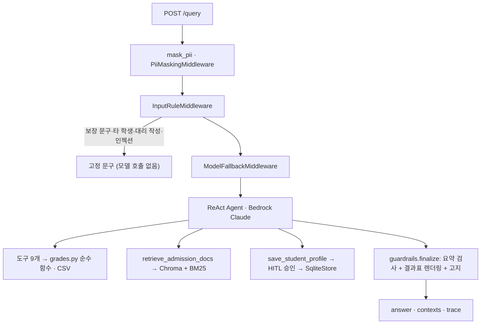

# 미니 PJT: 입시나침반

> 5등급제 첫 세대 고1 학부모를 위한 지원 가능권 상담 에이전트 · **계산·환산·판정은 코드가, LLM은 요약만**

## 무엇을 푸나
2025년 고1부터 내신이 5등급제로 바뀌었지만, 공개된 과거 입결(2025·2026학년도)은 모두 9등급 기준이라 "평균 2.3등급이면 어디까지?"를 판단할 기준이 없습니다. 입시나침반은 학기별·과목별 성적으로 학점 가중 평균과 9등급 환산값을 계산하고, 대학별 입결과 비교해 **안정·적정·소신·상향(도전)·격차 큼**으로 나눈 뒤, 한 단계 위 대학을 위해 남은 학기에 무엇을 얼마나 올려야 하는지 알려 줍니다.

> **데이터 범위:** 간호(4년제 17곳 + 전문대 5곳)와 컴퓨터공학(4년제 16곳 + 전문대 3곳) 두 계열. 전문대 중 입결이 있는 곳은 동남보건대·삼육보건대(간호), 신구대(컴퓨터)이고, 수원과학대·광주보건대·경민대는 시행계획의 반영 방법만 있어 '입결 미공개'로 표시합니다. 2025·2026 입결(어디가·전문대학포털·대학 발표), 2028학년도 시행계획(2029 대입 참고치), 대학별 권장과목, 교육부 2028 대입개편 자료. 구조는 학과와 무관합니다.

| 문서 | 내용 |
|---|---|
| [SERVICE.md](SERVICE.md) | 서비스 기획 (사용자·가치·도구·가드레일·성공 기준) |
| [TASKS.md](TASKS.md) | 구현 작업 목록과 확인 방법 |
| [docs/ARCHITECTURE.md](docs/ARCHITECTURE.md) | 구현 기준 아키텍처·패턴 적용 |
| [docs/DATA_COLLECTION_GUIDE.md](docs/DATA_COLLECTION_GUIDE.md) | 데이터 수집 출처·방법 |
| [evaluation/](evaluation/) | 평가셋 28건, 채점기, 라운드별 리포트 |

## 제출자 설명
입시나침반은 5등급제 첫 세대 고1 학부모가 자녀의 학기별 성적으로 수도권·비수도권 4년제와 전문대 지원 가능권을 가늠하고, 무엇을 보강할지 찾도록 돕는 상담 에이전트입니다. 평균·5→9등급 환산·판정·What-if는 파이썬 순수 함수가 계산하고, 숫자 표도 코드가 그려 붙이므로 모델이 숫자를 지어낼 수 없습니다. LLM(Bedrock Claude)은 출처·학년도와 함께 요약만 씁니다. 개인정보를 기록 전에 가리고, 합격 보장 문구·타 학생 성적·세특 대리 작성·프롬프트 인젝션은 모델 호출 전에 막습니다. 시행계획·모집요강은 하이브리드 RAG로 문서명·쪽까지 인용하고, 프로필 저장은 사용자 승인 후에만 합니다. FastAPI 웹 화면 6개와 상담 API로 쓸 수 있고, 평가셋 28건을 교안 방식(유형별 자동 판정 + LLM 심사 + RAGAS)으로 채점했습니다.

## 활용한 패턴 (Day 1~7, 12개 중 10개)
- **LCEL + Pydantic** — 도구 입력 스키마(`SubjectGrade`·`SimulateInput`), judge `with_structured_output` → `with_retry` → `with_fallbacks`
- **RAG** — 시행계획·모집요강·교육부 문서 하이브리드 검색(Chroma Titan v2 + BM25 kiwipiepy, RRF), 대학 필터, 문서명·쪽 인용
- **ReAct · 도구 다중** — `create_agent` + 도구 9개(평균 → 환산 → 입결 → 판정 → What-if → 권장과목)
- **가드레일 · 미들웨어** — 개인정보 마스킹, 모델 호출 전 규칙 차단, 모델 대체(us → global → sonnet-4-6), 출력 요약 검사
- **HITL** — `HumanInTheLoopMiddleware`로 프로필 저장 승인
- **메모리** — `SqliteSaver` 대화 유지, `SqliteStore` 별칭 프로필
- **Observability** — 응답 `trace`(마스킹·차단·모델 호출 토큰·도구·출력 검사·승인·총 시간)
- **평가** — 교안 `run_eval` 방식 유형별 판정 + `llm_judge` + RAGAS, 라운드별 리포트
- 미구현: MCP, Multi-Agent Supervisor

## 아키텍처

상세는 [docs/ARCHITECTURE.md](docs/ARCHITECTURE.md).

## 눈에 띄는 점
- **위험 요청은 모델 호출 전에 끝난다** — `src/middleware.py` `InputRuleMiddleware`가 규칙에 걸린 질문에 `src/replies.py` 고정 문구로 답하고 모델을 부르지 않는다. 정상 질문(세특 관리 방법 등)은 막지 않는 것을 확인했다.
- **숫자는 모두 코드에서 나온다** — `src/grades.py` 순수 함수(테스트 45개)가 평균·환산·판정·What-if를 계산하고, `src/guardrails.py`가 도구 결과로 표를 그린다. LLM 요약에 도구 결과에 없는 소수·보장 표현이 있으면 요약을 빼고 결과표만 보여 준다.
- **What-if는 남은 학기 기준** — 이미 받은 고1 성적은 바꿀 수 없으므로, 목표 컷을 5등급으로 역환산해 "남은 학기 평균 몇이면 소신선·적정선인지"를 계산한다.
- **개인정보는 기록에 남지 않는다** — 체크포인터가 첫 입력을 이력에 그대로 저장한다는 것을 테스트로 찾아, 그래프 입구에서 먼저 가리도록 고쳤다(새 DB에 이름·학교·연락처 0건).
- **학년도·전형 변화를 자동 안내** — 2026 입결 전형이 2028 시행계획에서 바뀌면(한서대 교과전형 통합, 인천대 지역균형 미모집) 결과에 자동으로 붙인다.

## 실행 방법
```bash
python -m venv .venv
.venv\Scripts\activate          # macOS/Linux: source .venv/bin/activate
pip install -r requirements.txt
```
1. `.env`에 AWS 자격 증명(`AWS_ACCESS_KEY_ID`, `AWS_SECRET_ACCESS_KEY`, `AWS_DEFAULT_REGION=us-east-1`)을 넣습니다. `.env`는 커밋하지 않습니다.
2. (RAG) 원본 PDF·HWP는 저작권·용량 문제로 커밋하지 않았습니다. `data/raw/policies/`에 시행계획을 두고 쪽 표시 텍스트를 `data/raw/text/`에 만든 뒤 `python -m src.retriever --build`로 인덱스를 만듭니다. 인덱스가 없어도 계산·판정·입결 기능은 동작합니다.
3. 서버 실행: `uvicorn src.api:app --port 8000` → 화면 http://localhost:8000 · API 문서 http://localhost:8000/docs
4. 터미널 상담: `python -m src.agent "질문"`
5. 테스트: `pytest tests/test_grades.py` · 평가: `python -m evaluation.run_eval --round 2 --ragas`

## RAGAS 평가 결과
(채점 후 기입)

## 인-아웃 세트 통과율 (자체 평가)
(채점 후 기입)

## 트라이앤에러 회고
(채점 후 기입)

## 진입점 · 핵심 코드 위치
| 파일 | 역할 |
|---|---|
| `src/api.py` | FastAPI: `POST /query`·`/query/resume`, 계산 API(`/api/grades/analyze`·`/api/predict`·`/api/simulate`·`/api/courses`·`/api/profile`), 화면 서빙 |
| `src/agent.py` | `create_agent` 조립, 시스템 프롬프트, 미들웨어 순서, `ask`·`resume` |
| `src/middleware.py` | 개인정보 마스킹, 모델 호출 전 규칙 차단 |
| `src/grades.py` | 평균·환산·판정·What-if 순수 함수 |
| `src/data_store.py` | CSV 로드·조회, 학과 키워드 매칭, 프로필 저장소 |
| `src/tools.py` | 도구 9개 |
| `src/retriever.py` | 하이브리드 RAG |
| `src/guardrails.py` | 결과표 렌더링, 요약 검사 |
| `web/` | 화면 6개(성적 입력·분석·지원 가능 대학·보강 과목·로드맵·상담) |
| `evaluation/run_eval.py` | 평가셋 실행·채점·RAGAS |
