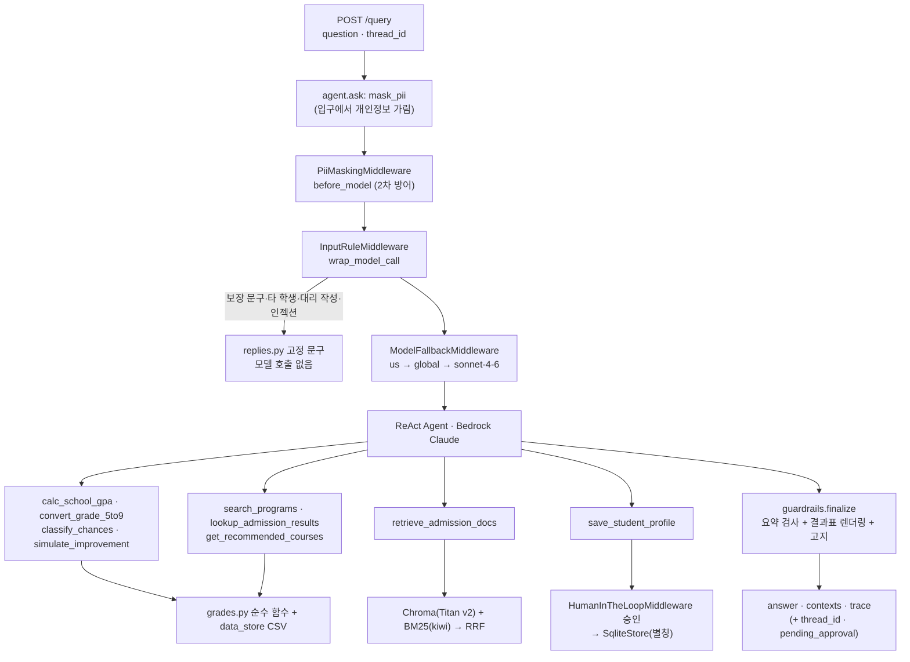

# 아키텍처 · 입시나침반 (구현 기준, 2026-11-04)

> **계산·환산·분류는 코드가, LLM은 요약만 담당**
>
> 개발 전 목표 설계를 실제 구현에 맞춰 고친 문서입니다. 계획과 달라진 점은 §7에 따로 적었습니다.

## 1. 태그
**패턴**: ReAct 에이전트 + 도구 9개 · 모델 호출 전 규칙 차단(LLM 우회) · 판정 순수 함수(grades.py) · 결과표 코드 렌더링(숫자 환각 차단) · 출력 검사(위반 시 결과표만) · 하이브리드 RAG(시행계획·모집요강·교육부) · HITL 프로필 저장 · SQLite 체크포인터 대화 유지 · LangGraph Store 프로필 · 단계별 trace · LLM-as-Judge + RAGAS

**스택**: Python 3.14 · FastAPI · LangChain 1.x(`create_agent`, 미들웨어) · LangGraph(SqliteSaver, SqliteStore) · Amazon Bedrock(Claude Sonnet 4.5, 대체 모델 2개) · Titan Embeddings v2 · Chroma · BM25(kiwipiepy) · RAGAS · 정적 HTML+JS 화면

## 2. 무엇을 푸나
학부모가 고1 학기별·과목별 5등급제 내신을 입력하면, 수도권·비수도권 4년제·전문대 지원 가능권을 안정·적정·소신·상향·격차 큼으로 나누고, 한 단계 위 대학을 위해 남은 학기에 무엇을 얼마나 올려야 하는지 계산해 주는 상담 에이전트다. 에이전트는 도구 9개를 쓰지만, 중심은 에이전트 앞뒤의 코드 계층이다.
- 위험 요청(합격 보장 문구, 타 학생 성적, 세특 대리 작성, 인젝션)은 모델 호출 전에 고정 문구로 끝난다.
- 평균·환산·판정·What-if는 `grades.py` 순수 함수가 계산한다.
- 숫자가 들어가는 표는 도구 결과로 코드가 그린다. LLM은 3~6줄 요약만 쓰고, 그 요약도 코드가 검사한다.
- 시행계획·모집요강·교육부 자료 같은 문서 질문만 RAG로 찾고 문서명·쪽을 인용한다.

## 3. 아키텍처

## 4. 처리 흐름
- `POST /query`는 같은 `thread_id`로 `SqliteSaver` 체크포인트를 이어 대화와 성적을 유지한다(평가 17·23번 "앞에서 말한 성적 그대로").
- 질문은 그래프에 넣기 전에 `mask_pii`로 이름·학교명·반·연락처를 가린다. 체크포인터는 첫 입력을 이력에 그대로 저장하므로 미들웨어만으로는 기록에 원문이 남는다(B2에서 확인). 미들웨어는 2차 방어다.
- `InputRuleMiddleware`는 새 질문 직후의 모델 호출에서만 규칙을 검사하고, 걸리면 `AIMessage(name="input_guard")`를 돌려 모델을 부르지 않는다(교안 day5 `InputGuardrailMiddleware` 방식).
- 도구 결과(JSON)는 `api._tool_results`로 모아 `guardrails.finalize`가 결과표·고지를 붙이고, `_tool_contexts`가 근거(contexts)로 바꾼다. RAG 결과는 청크 원문이 그대로 근거가 된다.
- 프로필 저장은 `HumanInTheLoopMiddleware`가 실행 직전에 멈추고, `/query` 응답에 `pending_approval`이 담긴다. 화면에서 승인하면 `/query/resume`가 `Command(resume=…)`로 이어 간다.
- 계산·조회 화면(`/api/grades/analyze`, `/api/predict`, `/api/simulate`, `/api/courses`)은 LLM 없이 도구를 직접 호출한다.

## 5. 눈에 띄는 점 (코드 경로로 보장)
1. **위험 요청은 모델 호출 전에 끝난다** — `src/middleware.py` `RULES`·`InputRuleMiddleware`, `src/replies.py`

   | 규칙 | 평가 |
   |---|---|
   | guarantee: "무조건/확실히 … 붙 … 써줘", "합격 보장 문구" | 18 |
   | other_student: 친구·같은 반·반 N등의 성적 조회·비교 | 19 |
   | proxy_writing: 세특·자소서·생기부 문구 대리 작성 | 20 |
   | injection: 지시 무시, 시스템 프롬프트, DB·CSV 원본 출력 | 21 |

   | (안내) future_grade: 앞으로 받을 과목 등급 예측 요청 → 예측 불가 + 시나리오 계산 제안 | 25 |
   | (안내) clarify_scale: 등급 체계 없이 평균 하나만 준 지원 가능 질문 → 5·9등급제 되묻기(5등급이면 환산값은 `convert_5to9`로 계산) | 16 |

   안내 규칙은 거절 문구 없이 되묻기·대안만 답하고, 앞 대화에서 등급 체계를 밝혔으면 묻지 않는다. 전문대 비하 질문(28)은 막지 않고 중립적으로 답한다. 정상 질문(세특 관리 방법, 자소서 제출 여부 등)은 규칙에 걸리지 않는 것을 확인했다.
2. **판정은 순수 함수다** — `src/grades.py`: `weighted_average`·`gpa_summary` → `to_percentile`·`to_grade9` → `classify(g, c)`(차이를 소수 둘째 자리로 맞춘 뒤 구간 판정) → `baseline_cut`(70% → 50% → 전문대 평균) → `grade9_to_avg5`·`required_future_avg`·`group_effects`(What-if). `tests/test_grades.py` 45개가 평가셋 정답 숫자로 검증한다.
3. **숫자 표는 코드가 그린다** — `src/guardrails.py` `render_*`. LLM 요약에 보장 표현·비하·도구 결과에 없는 소수가 있으면 요약을 빼고 결과표만 보여 준다(재시도 없이 지연 없음). 22번 기준 표의 소수 69개가 모두 도구 결과와 일치했다.
4. **학년도·등급 체계를 데이터로 구분한다** — 입결은 `grade_scale=9`, 정시는 `cut_metric=평균백분위`라 판정에서 뺀다. 2028 전형명이 2026 입결 전형과 다르면(한서대 교과1·2 통합, 인천대 지역균형 미모집) 결과에 자동으로 안내한다.
5. **What-if는 남은 학기 기준이다** — 고1 성적은 바꿀 수 없으므로, 목표 컷을 5등급으로 역환산해 남은 학기(3학년 1학기까지)에 필요한 평균을 소신선·적정선으로 보여 준다.

## 6. 진입점
| 파일 | 역할 |
|---|---|
| `src/api.py` | FastAPI: `POST /query`, `POST /query/resume`, `/api/grades/analyze`, `/api/predict`, `/api/simulate`, `/api/courses`, `/api/profile`, `GET /health`, 화면(`web/`) 서빙 |
| `src/agent.py` | `create_agent` 조립, 시스템 프롬프트, 미들웨어 순서, `ask`·`resume`, 터미널 실행 |
| `src/middleware.py` | `mask_pii`, `PiiMaskingMiddleware`, `InputRuleMiddleware` |
| `src/replies.py` | 고정 거절·안내 문구 |
| `src/grades.py` | 평균·환산·판정·What-if 순수 함수 |
| `src/data_store.py` | CSV 로드·조회, 학과 키워드 매칭, 프로필 저장소(SqliteStore) |
| `src/tools.py` | 도구 9개 |
| `src/retriever.py` | 텍스트 청크, Chroma + BM25 하이브리드(RRF), 대학 필터 |
| `src/guardrails.py` | 결과표 렌더링, 요약 검사, 최종 답변 조립 |
| `web/*.html` | 화면 6개(성적 입력·분석·지원 가능 대학·보강 과목·로드맵·상담) |
| `tests/test_grades.py` | 순수 함수 단위 테스트 45개 |
| `evaluation/run_eval.py` | 28건 실행·유형별 자동 판정·llm_judge·RAGAS → `roundN_report.md` |

## 7. 12개 패턴 적용 (구현 10개)
| # | 패턴 | 적용 위치 | 상태 |
|---|---|---|---|
| 1 | LCEL + Pydantic | 도구 입력 스키마(`SubjectGrade`·`SimulateInput`), judge `with_structured_output` → `with_retry` → `with_fallbacks` | 구현 |
| 2 | ReAct | `agent.py` `create_agent` + 도구 9개 | 구현 |
| 3 | RAG | `retriever.py` 하이브리드(벡터+BM25, RRF), 학과명 쿼리 확장은 `data_store.find_programs` 키워드 | 구현 (리랭커는 미적용) |
| 4 | 도구 다중 | 평균 → 환산 → 입결 → 판정 → What-if → 권장과목 | 구현 |
| 5 | MCP | — | 미구현 (선택) |
| 6 | 가드레일 | 입력: 마스킹 + 규칙 차단 / 출력: 요약 검사 + 결과표 | 구현 |
| 7 | HITL | `HumanInTheLoopMiddleware` → `save_student_profile` | 구현 |
| 8 | 미들웨어 | PII 마스킹, 입력 규칙, 모델 대체, HITL | 구현 |
| 9 | Multi-Agent Supervisor | — | 미구현 (선택) |
| 10 | 장기 메모리 | `SqliteStore` 별칭 프로필 / Plan-Execute는 미구현 | 구현(메모리) |
| 11 | Observability | 응답 `trace`: pii_mask·input_guard·model_call(모델·토큰)·tool_call/result·output_guard·human_approval·total | 구현 (LangSmith 미연동) |
| 12 | 평가 | `run_eval.py` 유형별 판정 + llm_judge + RAGAS, `round1~3_report.md` | 구현 |

**계획 대비 달라진 점**: 입력 차단은 `before_model`의 `jump_to` 대신 교안 day5처럼 `wrap_model_call`로 했다. 출력 가드레일은 LLM 2차 검사·재시도 대신 "코드 검사 → 위반 시 결과표만"으로 단순화했다(지연을 늘리지 않기 위해). `TraceMiddleware`·`judge.py`는 따로 만들지 않고 trace는 `api.py`가, judge는 `run_eval.py`가 맡는다. 등급 체계 되묻기(16번)는 처음에 프롬프트로 처리했으나 Round 2에서 모델이 되묻지 않아, Round 3부터 입력 규칙(`match_guide`)으로 옮겼다. 수도권 밖 대학은 별도 규칙 없이 한 목록으로 함께 보여 준다.

## 8. README 작성 규칙
- 리뷰어는 README에 적힌 평가 결과를 읽는다. 1차·2차 통과율과 RAGAS 값을 README에 직접 적고 `evaluation/roundN_report.md`와 숫자를 맞춘다.
- "눈에 띄는 점"은 코드 경로로 보장되는 설계를 쓴다.
